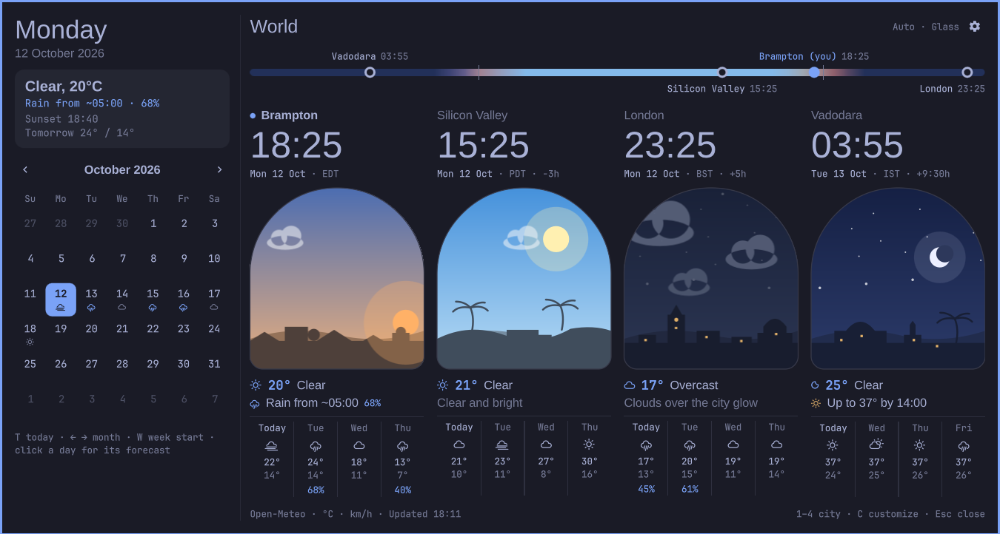
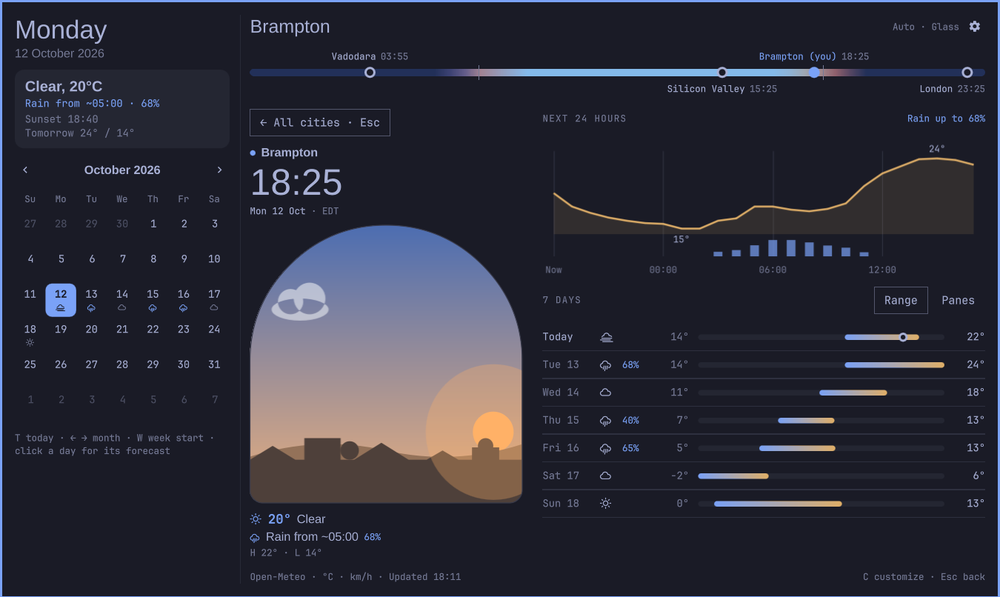
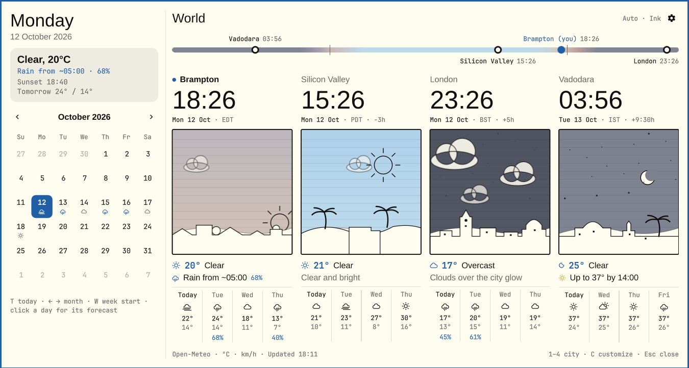
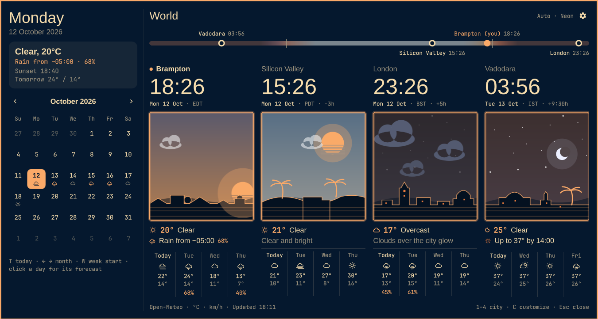

# Worldscape

A calendar, world-clock and weather plugin for the Omarchy shell. Four cities,
one panel, with light and dark palettes inherited from your desktop theme.

**Development preview — not a stable release.** The native widget implements a
first iteration of the *Windows on the world* design: each city is an illustrated
window whose sky follows that city's real time of day and current weather. Each
card reads top to bottom: time, the window, then the weather. The repository has not been submitted to
the Omarchy plugin marketplace. See [docs/NATIVE-ITERATION.md](docs/NATIVE-ITERATION.md)
for how it is built and what is not done yet.

## Native previews

Captured from the running Omarchy widget in Auto mode. Weather and clocks are
live; each city keeps its own daylight regardless of the interface palette.

**Tokyo Night · Glass**



**Tokyo Night · city focus** (click a card or press 1–4)



**Flexoki Light · Ink**



**Retro 82 · Neon**



## Opinionated by default. Malleable by design.

Worldscape should feel carefully composed the first time you open it: considered
spacing, readable information, expressive weather, and a palette that belongs on
your desktop. The default is our best recipe, ready to enjoy without setup.

A small **Customize** menu will offer the useful everyday adjustments: compact or
expanded weather, clocks and calendar; show or hide the calendar; choose cities,
units, and what appears in the bar, including its date/time format. A few curated
visual designs can share those choices. Each adjustment should still produce a
coherent result, without making you design the widget yourself.

Beyond that menu, the source is yours to reshape, by hand or with your agent.
Change the artwork, layout, interactions, data sources, or the whole composition.
The menu is a convenience, not the boundary of what Worldscape can become—in the
spirit of Omarchy and a Linux desktop you can make your own.

See [the design principles](docs/PRINCIPLES.md) for the decisions that guide
implementation.

## What the panel shows

- **City windows.** Four windows (from `locations.json`) with recognisable
  silhouettes: the CN Tower for Toronto, hills and palms for Silicon Valley,
  Elizabeth Tower and St Paul's for London, a palace dome and minaret for
  Vadodara. Any other city gets neighbourhood rooftops. The sky moves
  continuously through night, first light, sunrise, day, golden hour and dusk
  using sunrise/sunset calculated locally from each city's coordinates. The sun
  or moon follows its arc, lamps come on at dusk, and the Open-Meteo condition
  adds cloud, rain, snow, fog or lightning.
- **Above the window.** City, local time, and date · timezone · offset from you.
  The day ribbon sits above the cards, with the clocks.
- **Below the window.** Current condition and temperature, then what changes next ("Rain from
  ~21:00 · 70%", "Clearing by ~18:00", "Up to 37° by 15:00", frost), or the
  one-line mood when nothing does. A strip shows today and the next three days
  with high/low and rain chance (from 30%).
- **City focus.** Click a city card or press **1–4** for a large window, the
  next 24 hours as a temperature line over rain-chance bars, and seven days as
  range bars on one shared scale or as small windows drawn with each day's
  weather. **Esc** returns to all cities.
- **Calendar.** Weekday headline, a home weather card (condition, temperature,
  what's next, sunrise or sunset, tomorrow's range) and a navigable month grid.
  The next seven dates carry the home forecast; click one to preview that day.
- **Day ribbon.** Every city placed on one 24-hour band coloured by the home sky,
  labelled with its name and time, with home sunrise and sunset ticks.
- **Honest weather states.** With no forecast the window shows a muted sky
  with a faint sun/moon (time is known, conditions are not) and says
  "No forecast". Offline, the last saved forecast is used and labelled.

The interface colours follow your Omarchy theme's light or dark palette; the
scene's daylight is independent, so a light desktop can show a moonlit city.

### Window styles and Auto

Four styles change the frame and the scene treatment: **Glass** (arched
window, smooth sky), **Woodblock** (matted print, banded sky), **Ink** (ruled
frame, line drawing) and **Neon** (glowing edge, striped sun, horizon grid).
Typography stays the same in every style, to keep the panel easy to read: the
desktop sans for names, time and prose, the shell's monospace for data.

**Auto** is the default. It reads the live theme palette (and reacts when you
switch themes). For installed Omarchy themes it uses a curated pick, for
example Glass for Tokyo Night, Woodblock for Gruvbox, Ink for Nord and Neon for
Retro 82. For any other palette it borrows the pick of the nearest installed
theme by OKLab distance and says which one it chose. Picks are aesthetic
choices, not a popularity ranking.

### Customize

Click the gear (or press **C**) in the panel. Choices are saved in this widget's
`shell.json` entry and are shared by every style:

| Choice | Options |
| --- | --- |
| Window style | Auto, Glass, Woodblock, Ink, Neon |
| Motion | Animated, Quiet |
| World clocks | Expanded, Compact |
| Weather | Expanded (next change and forecast strip), Compact (current only) |
| Time | 12-hour, 24-hour |
| Temperature | °C · km/h, °F · mph |
| Calendar | Expanded, Compact, Hidden |
| Week starts | Sunday, Monday |
| Bar time | day + time, date + time, time only |
| Bar weather | Show, Hide |

**Reset to defaults** removes only these keys. Animation only runs while the
panel is open, and Quiet keeps a still frame (rain streaks and a lightning bolt
remain visible).

Keys in the panel: **T**/Enter today, **← →** month, **W** week start, **1–4**
city focus, **C** Customize, **Esc** back from a city or close. Inside Customize: **↑ ↓** row, **← →** option,
**Enter**/Space apply, **Tab**/Shift+Tab next/previous row (including Reset and
Done), **Esc** or **C** back. The widget's IPC target
`io.github.binarysentient.worldscape` exposes `open`, `close`, `toggle`,
`refresh`, `cycleFormat`, `toggleWeekStart` and `customize`, e.g.
`omarchy-shell io.github.binarysentient.worldscape customize`.

## Install the development version

Requires Omarchy's Quickshell-based shell (baseline: Omarchy 4.0.4), Python 3.9+
with system timezone data, and the shell's Nerd Font glyphs. Other Omarchy
versions have not yet been verified.

```bash
omarchy plugin add https://github.com/binarysentient/omarchy-worldscape.git --enable
```

Plugin ID: `io.github.binarysentient.worldscape`.
This is a separate widget; it does not automatically replace the built-in clock
or an existing personal clock clone. Arrange or disable those through Omarchy's
bar/plugin controls after trying it.

Click the clock to open the panel; right-click cycles the bar's date formats;
middle-click opens Omarchy's timezone picker. Both theme modes follow the shell.

## Design lab

Open [docs/design-lab/index.html](docs/design-lab/index.html) locally in a browser.
It includes Atmosphere, Paper Worlds, Pixel Postcards, Observatory and Field Notes,
with paired day/night previews. Try the weather selector, hour slider, and Customize
button. Keep multiple designs and adjust each design independently; these choices
are saved in that browser's local storage, not in your live desktop configuration.
The data and date in this prototype are illustrative, not live forecasts.

### Independent design studies

[Open the comparison page](docs/design-studies/index.html) locally to explore
independent concepts by Claude Opus 5.5 and GPT-6.1 Sol, both at medium effort.
Each proposes Auto matching for representative Omarchy palettes and custom themes,
with weather/daytime artwork and a small set of quick adjustments. The Opus study
(*Windows on the world*) is the direction the native widget now implements; the
studies themselves remain prototypes with simulated data and lab-only controls
(theme simulator, time scrubber, weather override, palette pinning) that the
native widget does not ship.

## Locations and privacy

`locations.json` currently defines four example cities, their IANA timezones and
coordinates. Edit existing entries in the installed plugin to change cities.
The current implementation assumes four cards; arbitrary city counts and an
in-widget location editor are planned. Update `country` alongside city/coordinates.

Weather requests go directly to [Open-Meteo](https://open-meteo.com/), using the
configured coordinates. Each request asks for current conditions, seven days and the next 25 hours.
Forecasts are cached for 15 minutes in
`$XDG_CACHE_HOME/omarchy-worldscape` (normally `~/.cache/omarchy-worldscape`).
The clock reads local timezone data and cached weather without waiting on network
requests. Weather refreshes happen separately; the last forecast is retained offline.

Automatic location detection is **disabled by default**. Setting `enabled` to
`true` in `local-location.json` opts into requests to `https://wttr.in/?format=j1`,
which infers a city from your public IP. That legacy feature currently replaces
a matching country card for Canada, the US, the UK or India. A general location
configuration interface is planned. No detected location cache is included here.

## Development

The root `manifest.json` describes the single installable plugin. QML and JS files
implement its bar button and popup; Python helpers provide time and weather data.
Start with `Panel.qml` for layout, `CityWindow.qml` for the artwork, `Skylines.js`
for city silhouettes, `Sky.js` for daylight/weather mapping and `ThemeMatch.js`
for Auto picks.

```bash
omarchy plugin validate .
python3 -m py_compile combined.py weather.py world_clocks.py
python3 combined.py  # cached/offline clock read; no network request
```

See [the roadmap](docs/ROADMAP.md) for the next steps. Local development copies can be tested separately from the published version.
Back up the current plugin and shell.json before replacing a personal clock.

## Credits and license

MIT; see [LICENSE](LICENSE). Calendar/clock and shared UI logic derive from
[Omarchy](https://github.com/omacom/omarchy), copyright David Heinemeier Hansson.
Worldscape additions and design studies by binarysentient / Thundermonkey.

Weather data by [Open-Meteo](https://open-meteo.com/), under
[CC BY 4.0](https://open-meteo.com/en/licence); API usage is subject to its
[terms](https://open-meteo.com/en/terms). Optional IP-based city lookup uses
[wttr.in](https://github.com/chubin/wttr.in). Fonts come from the host system;
the native windows and the design lab use code-drawn artwork and bundle no
external graphics or fonts. The native *Windows on the world* scenes are original
work by Claude Opus 5.5 for this project; theme colour values in `ThemeMatch.js`
belong to their respective Omarchy theme authors.
